<p align="center">
  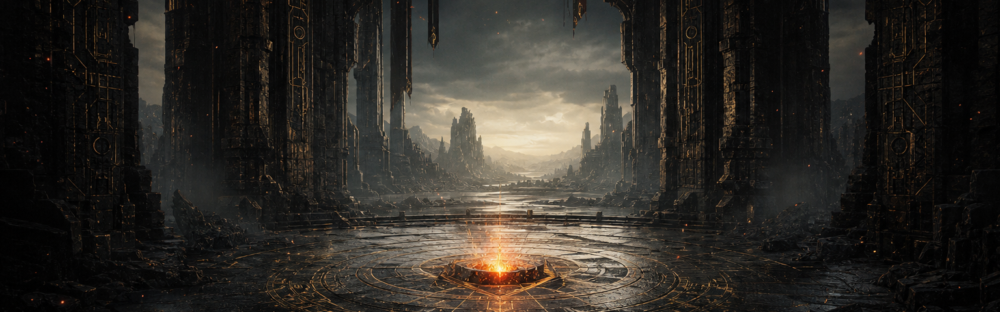
</p>

<h1 align="center">Augusto de Barros Almeida</h1>

<p align="center">
  <strong>Fullstack that reaches production tested, secure and observable.</strong><br />
  <sub>Fullstack engineer · São Paulo, Brazil · context, decision and evidence, in that order.</sub>
</p>

<p align="center">
  <a href="https://augustoalmeidadev.com.br/">
    
  </a>
  <a href="https://www.linkedin.com/in/augustobalmeida/">
    
  </a>
  <a href="mailto:augustob.almeida12@gmail.com">
    
  </a>
</p>



I build end to end in TypeScript, React, NestJS and Java/Spring Boot, and I only call something done after it has been tested, measured and reviewed for security. That is where the problem the happy path hides shows up.

Today at **Stech** I fix vulnerabilities in financial systems, I delivered a whole education platform, and I build tools with AI agents. In them, the model does not review its own code, authorization comes before the prompt, and every run has a time limit and a cost measured in tokens.

Before development I looked for root causes in market intelligence at **Itaú** and worked SLA-bound support at **Sintel**, where an incident has a deadline. I also taught at **Cebrac**: a twelve-class track from zero to Power BI and an AI workshop for fifteen students.

```text
CURRENT QUEST
├── Ship end-to-end products with TypeScript, React, NestJS and Java
├── Measure before optimizing: execution plans, indexes, N+1
├── Keep application security in acceptance, CI pipeline included
└── Put AI agents to work behind an action gate, never on their own word
```




<a href="https://augustoalmeidadev.com.br/projetos/taskforge">
  
</a>
<p align="center">
  Turns a request into a task graph, isolates each task in its own Git worktree and runs them in parallel waves. The planner is read-only, and no agent can publish on its own.<br />
  <code>Agents</code> <code>Git worktrees</code> <code>DAG</code> <code>Human merge</code>
</p>

<a href="https://augustoalmeidadev.com.br/projetos/conn-pod">
  
</a>
<p align="center">
  Splits AI work across different models: one executes, another verifies. Each role has declared scope, bounded retries and an evidence receipt tied to the version.<br />
  <code>Multi-model</code> <code>Sandbox</code> <code>Evidence receipts</code>
</p>

<a href="https://augustoalmeidadev.com.br/projetos/jarbas">
  
</a>
<p align="center">
  An assistant over a Markdown vault built around an action gate: every write the agent attempts is validated as a plan before it touches a file. Fail-closed by default, with an append-only journal.<br />
  <code>Agents</code> <code>Schema-first</code> <code>145 tests</code> <code>ADRs</code>
</p>

<a href="https://augustoalmeidadev.com.br/projetos/stechclub">
  
</a>
<p align="center">
  An education platform delivered end to end: company SSO, tracks, video served through signed S3 links, quizzes and an admin panel. Used today by 15+ mentees.<br />
  <code>React</code> <code>NestJS</code> <code>Prisma</code> <code>AWS S3</code>
</p>

<a href="https://augustoalmeidadev.com.br/projetos/portfolio-api">
  
</a>
<p align="center">
  The api behind my site: one Go binary with SQLite on a free VPS, content derived from git, and a release that rolls itself back if the new version doesn't come up. 14 MB of memory on its first release.<br />
  <code>Go</code> <code>SQLite</code> <code>Caddy</code> <code>systemd</code>
</p>

<details>
  <summary><strong>Lesser foes</strong> · public repositories</summary>
  <br />

  - [Repo Explorer](https://github.com/AuggieAlmeida/repo-explorer) — Angular 22 explorer with explicit UI states, request cancellation, caching and Vitest.
  - [Pasta la Vista](https://github.com/AuggieAlmeida/Pasta-la-Vista) — mobile delivery platform across app, API, payments, cache and storage.
  - [YoutCatcher](https://github.com/AuggieAlmeida/YoutCatcher) — Python desktop media tool with MVC, structured logging and Pytest.
  - [MITRA](https://github.com/AuggieAlmeida/MITRA) — local-first desktop CRM for customers, service orders and payments.
</details>

<p align="center"><a href="https://augustoalmeidadev.com.br/projetos">Every case, with context, decision and evidence →</a></p>


<p align="center"><sub>Every role a bonfire lit — progress kept, never lost.</sub></p>


### Grand archives

- **Degree:** Multiplatform Software Development — FATEC Mauá, 2026
- **Languages:** Portuguese (native) · English (C1) · French (B1) · Spanish (A1)
- **Working principles:** tested before done, security in acceptance, accessibility, written decisions


<p align="center">
  The full ledger lives at <a href="https://augustoalmeidadev.com.br/">augustoalmeidadev.com.br</a> — career, cases, stack and writing, in Portuguese and English.
</p>

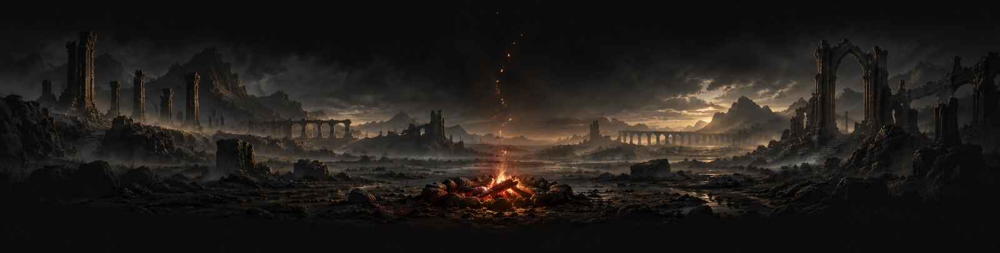


<p align="center">
  <sub>engenheiro fullstack · são paulo - BR</sub>
</p>
